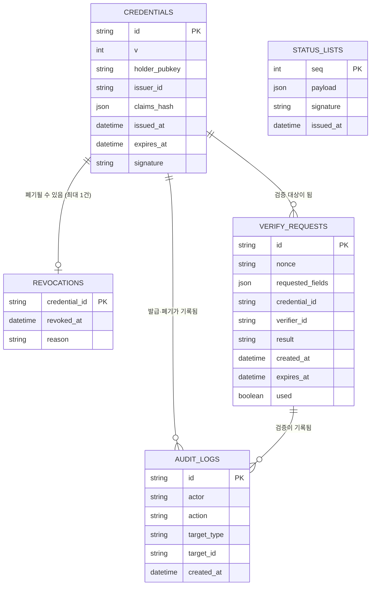

# 조사 노트

## 1. 핵심 개념

 DID : 개인이 스스로 소유하는 탈중앙 식별자. 중앙 기관 계정이 아니라 본인 소유의 ID | 소지자의 공개키를 ID처럼 사용 (단순화)
 VC (Verifiable Credential) : 발급자가 서명해서 내려준 증명서 원본. "이름·생년월일·거주지"를 담은 서명된 문서 | `credentials` 테이블의 증명서 한 건
 VP (Verifiable Presentation) : 소지자가 검증자에게 제출하는, VC 중 일부만 골라 담고 자기 서명을 더한 제출물 | 검증 요청에 대한 응답 (선택 공개 + nonce 서명)

## 2. 실제 방식과 내 구현의 차이

| 항목           | 실제 모바일 신분증             | 내 구현 (단순화)                                    |
|----------------|-------------------------------|----------------------------------------------------|
| 키 저장 위치   | 폰 보안 영역(TEE/eSE)          | 소지자 개인키는 소지자 로컬 파일(지갑 스크립트)에만 저장, 서버로 보내지 않음. 보안 영역이 없다는 점을 README 한계에 명시 |
| 신원 공유 방식 | 블록체인 기반 DID 등록          | 발급자 공개키를 파일로 배포 (발급자 단일 신뢰)       |
| 전달 방식      | QR 촬영 / BLE / NFC            | QR 코드 1가지만 구현                                |
| 선택적 공개    | 항목별 암호화·해시 후 부분 공개 | 항목별 salted hash로 단순화                          |

> 수정 메모(4일차): 기존에 "키 저장 위치: 서버 DB"로 적었으나, design.md 역할표의 "발급자는 소지자 개인키를 알면 안 됨"과 충돌해 바로잡았다. 소지자 개인키는 소지자 쪽에만 둔다.

## 3. 발급 항목

증명서(VC)에 담기는 항목이다. 원본 값이 아니라 항목별 salted hash로 `claims_hash`에 들어간다(서명 payload 명세는 design.md 6절).

| 항목명 | 타입 | 출처 | 쓰이는 곳 |
|---|---|---|---|
| `name` | string | 발급 입력 | 본인 확인 |
| `birth_date` | string (YYYY-MM-DD) | 발급 입력 | 필요할 때만 |
| `address` | string | 발급 입력 | 필요할 때만 |
| `residence_city` | string | 발급자가 `address`에서 도시만 추출 | 상품권 자격 (3주차) |
| `age_over_19` | bool | 발급자가 `birth_date`로 발급 시점 기준 계산 | 성인 확인, 상품권 자격 |

> 파생 항목(`residence_city`, `age_over_19`)을 발급자가 미리 만들어 두는 이유: 성인 확인마다 `birth_date` 전체를 공개하면 과다 수집(설계 약점 2번)을 막을 수 없다. "성인이다: true" 같은 최소 항목만 공개하기 위해서다.
> `age_over_19`는 발급 시점 기준이다. 발급 후 만 19세가 되는 사람은 재발급으로 해결하고 한계로 적는다(반대 방향, 미성년자가 성인으로 통과하는 일은 없다).

## 4. ERD

### ERD 설계 메모 (4일차 수정 반영)

| # | 바꾼 것 | 이유 |
|---|---|---|
| 1 | 폐기 관계를 1:N → **1:0..1** | `revocations`의 PK가 `credential_id`라서 한 증명서는 최대 한 번만 폐기된다. 3일차에 막혔던 관계가 이걸로 정리된다 |
| 2 | `verify_requests`에 `credential_id`(nullable), `verifier_id`, `result` 추가 | credentials–verify_requests 관계를 실제로 연결할 컬럼이 필요하다. 요청 생성 시점엔 어떤 증명서가 올지 모르므로 `credential_id`는 nullable, 제출 때 채운다 |
| 3 | `audit_logs`를 credentials·verify_requests 양쪽과 연결, `target_type` 추가 | 발급·폐기 로그는 증명서를, 검증 로그는 검증 요청을 가리킨다. `target_id` 하나로 두 테이블을 가리키므로 FK 대신 `target_type`(credential / verify_request)으로 구분한다 |
| 4 | `credentials`에 `v`(형식 버전) 추가 | design.md 6.1의 버전 규칙 |
| 5 | `status_lists` 테이블 신설 | 서명된 폐기 목록과 롤백 방지용 `seq`(순번)를 보관한다(design.md 5.3) |

> `status_lists`는 `revocations`를 그대로 두고 그 위에 얹는 "서명된 스냅샷 + seq"다. revocations가 진짜 상태이고, status_lists는 검증자에게 배포하는 서명본이다.
